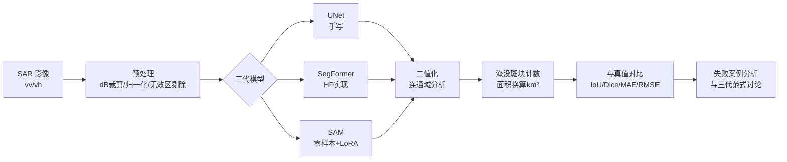

# CV 课程设计：基于 Sentinel-1 遥感影像的洪水分割与淹没统计

> 题目 6「图像分割与计数」变体 ｜ 2-3 人小组 ｜ 全部实验在服务器 H20 GPU 上完成
> 一句话：用三代分割技术（CNN → Transformer → 视觉大模型）在真实洪水卫星影像上做淹没区制图与灾情统计，对比它们在水利遥感场景下的优劣。

---

## 1. 作业原始要求

- **课程**：图像处理（计算机视觉）课程设计，3-2 人一组
- **选定题目**：题目 6「图像分割与计数」（选题范围内直接实现，无需特批）
- **文档七项内容**（JupyterNotebook 导出 PDF，`组序号文件夹/组序号.pdf`）：
  1. 题目
  2. 成员姓名、序号、学号（每人负责的内容）
  3. 需求分析：完成什么任务、技术方案、GitHub 链接
  4. 功能划分与处理模块流程图
  5. 分步骤运行结果及分析
  6. 最终效果展示（准确率讨论）
  7. 项目总结（哪些情况成功、哪些失败、原因讨论）

## 2. 选题动机（背景与特色）

| 成员背景 | 在本项目中的体现 |
| --- | --- |
| 本科：UNet 遥感语义分割研究 | UNet 基线 + 遥感数据处理经验直接迁移 |
| 研究生：水利 AI 大模型（数据集与微调方向） | 洪水监测是水利 AI 核心场景；SAM 微调实验展示"微调"技能 |

**报告叙事**：《从 CNN 到视觉大模型：三代图像分割范式在洪水淹没制图中的对比研究》——别的组没有 GPU 资源也没有这个研究视角，无法复制。

## 3. 技术方案

### 3.1 数据集：Sen1Floods11（现成、免标注）

| 项 | 说明 |
| --- | --- |
| 来源 | Cloud to Street，CVPR 2020 Workshop（github.com/cloudtostreet/Sen1Floods11） |
| 内容 | 4831 张 512×512 Sentinel-1 SAR 影像（vv/vh 极化，GeoTIFF，10m/像素） |
| 标注 | 0=非水、1=洪水、2=永久水体、**-1=无效区域（训练时必须从损失中剔除）** |
| 划分 | 官方提供 train/val/test 划分表，直接沿用保证可比性 |
| 注意 | 官方部分下载链接在 Google Drive（国内不通），优先走 Zenodo / hf-mirror / 国内搬运 |

### 3.2 模型：三代范式对比

| 模型 | 代表 | 实现 | 预期定位 |
| --- | --- | --- | --- |
| UNet | CNN 专用小模型 | 纯 PyTorch 手写（报告分量） | 小数据下可能反超 Transformer（核心分析点） |
| SegFormer (MiT-B2/B5) | Transformer 通用分割 | HuggingFace 官方实现 | 强但数据饥渴 |
| SAM | 视觉大模型 | 官方权重零样本 + **LoRA 微调** | 零样本域外翻车 → 微调救活（压轴戏） |

### 3.3 计数与统计（题目要求的核心输出）

1. 预测掩码 → 二值化 → 连通域分析 → **淹没斑块数量**
2. 10m/像素换算 → 每斑块面积与全图淹没总面积（km²，一张 tile ≈ 26 km²）
3. 与真值对比：斑块数误差、面积误差、逐样本散点图
4. 出洪水专题图（影像 + 淹没高亮 + 斑块编号）——"分割作业"升华为"灾情快速评估"

### 3.4 流程图草稿（报告第 4 项用，mermaid）



## 4. 实施流程（六阶段）

| 阶段 | 内容 | 产出 | 预计耗时 |
| --- | --- | --- | --- |
| 0 项目启动 | uv 环境、git 仓库推 Gitee、下载数据 | 可运行的空项目 + 数据就位 | 半天（下载视通道） |
| 1 数据探索 | 格式解析、EDA、SAR 预处理 | `01_data_exploration.ipynb` | 半天 |
| 2 模型训练 | UNet 手写、SegFormer 微调、指标评估 | `02_training_unet.ipynb`、`03_training_segformer.ipynb`、权重 | 1-2 天（可过夜） |
| 3 计数统计 | 连通域、面积换算、专题图 | `04_counting_statistics.ipynb` | 半天 |
| 4 SAM 对比 | 零样本推理 + LoRA 微调 | `05_sam_comparison.ipynb` | 半天-1 天 |
| 5 报告装配 | notebook 排版补文字、流程图、导 PDF | `组序号/组序号.pdf` | 1 天 |

机器纯计算时间约 8-15 小时（过夜排程），其余为人写报告时间。

## 5. 目录结构（规划）

```
cv-course-design/
├── README.md            ← 本文件
├── notebooks/           ← 按报告章节组织的 notebook（01-05）
├── src/                 ├── dataset.py 数据读取
│                        ├── unet.py     手写 UNet
│                        ├── train.py    训练循环
│                        ├── counting.py 连通域与面积统计
│                        └── sam_exp.py  SAM 零样本/LoRA
├── outputs/             ← 权重、指标、可视化图
└── 报告/                ← 导出的 PDF 与报告素材
```

数据集不在项目内，统一放 `~/datasets/Sen1Floods11/`（可重新下载，不进 git）。

## 6. 分工（实际）

| 成员 | 负责内容 |
| --- | --- |
| 本人 | 项目实施全程、报告文档撰写、课程汇报答辩 |
| 队友 1 | PPT 制作（题目背景与技术方案部分） |
| 队友 2 | PPT 制作（实验结果与总结部分） |
| Claude（AI 辅助） | 全部代码编写与调试、实验运行与过夜排程、notebook 组织、报告底稿与图表 |

- 报告第 2 项"每个人负责的内容"按此填写
- 汇报素材：由 Claude 产出 PPT 大纲 + 全部图表导出（指标表、对比图、专题图），队友只做排版美化
- 建议队友在收尾阶段参与结果截图核对、失败案例挑选等实质环节，报告里的分工表述更均衡

## 7. 验收标准（开工前预设）

- 各模型洪水类 IoU **达到公开基线 ±2 个点即收**；低于则诊断原因，最多再调两轮
- 判断依据：公开基线锚点 + train/val 曲线诊断（欠拟合/过拟合/平台期）+ 投入产出截断
- 技术问题按此标准拍板执行；截止时间、风险偏好等由组内决定

## 8. 风险与备案

| 风险 | 应对 |
| --- | --- |
| Sen1Floods11 下载通道不通（GDrive） | 依次试 Zenodo / hf-mirror / 国内搬运；都不行→ B 计划换 Roboflow 漂浮物数据集（叙事不变） |
| Transformer 打不过 UNet（小数据） | 不是翻车，是核心分析点："模型容量与数据规模的匹配" |
| 服务器磁盘（当前 90%，空闲 727G） | 本项目峰值 60G 无碍；长任务前查 df，空闲 <100G 切瘦身子集并清理 |
| 环境配置（PyTorch×CUDA） | 预留 0.5-1h 调试，正常范围 |

## 9. 参考资源

- 数据集官方仓库：<https://github.com/cloudtostreet/Sen1Floods11>
- 数据集论文：Sen1Floods11: A Georeferenced Dataset to Train and Test Deep Learning Flood Algorithms for Sentinel-1（CVPR 2020 Workshops）
- SegFormer：HuggingFace `nvidia/segformer-*` 系列
- SAM：Meta Segment Anything（HuggingFace `facebook/sam-vit-*`，国内走 hf-mirror）
- 备选数据集：Roboflow Floating Waste（universe.roboflow.com/garbagedetection-gqqya/floating-waste）
